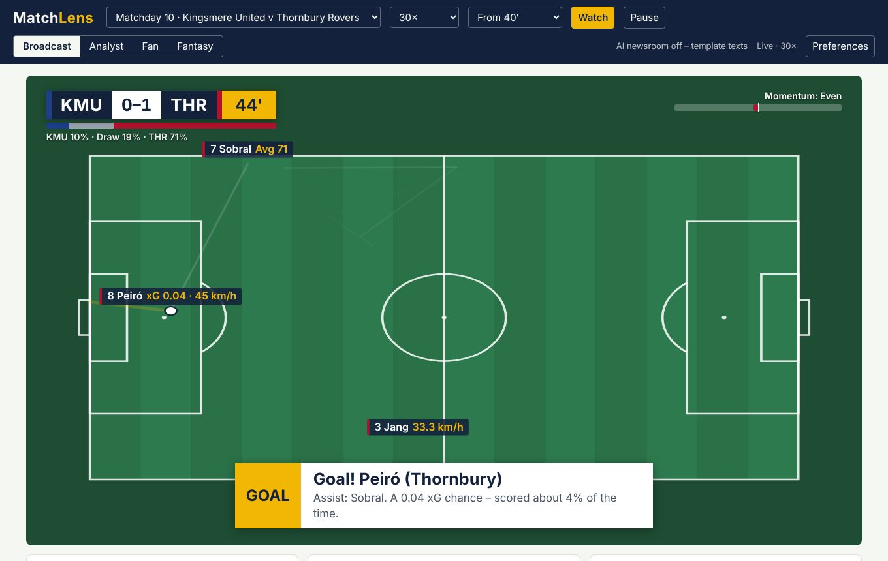
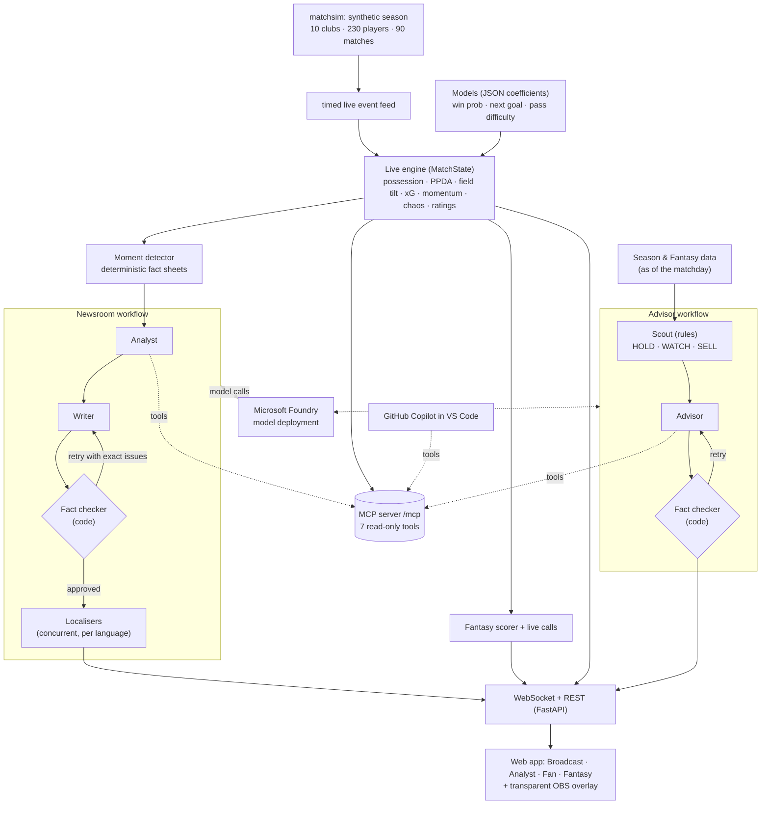
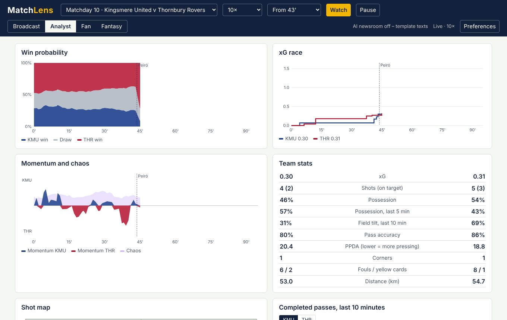
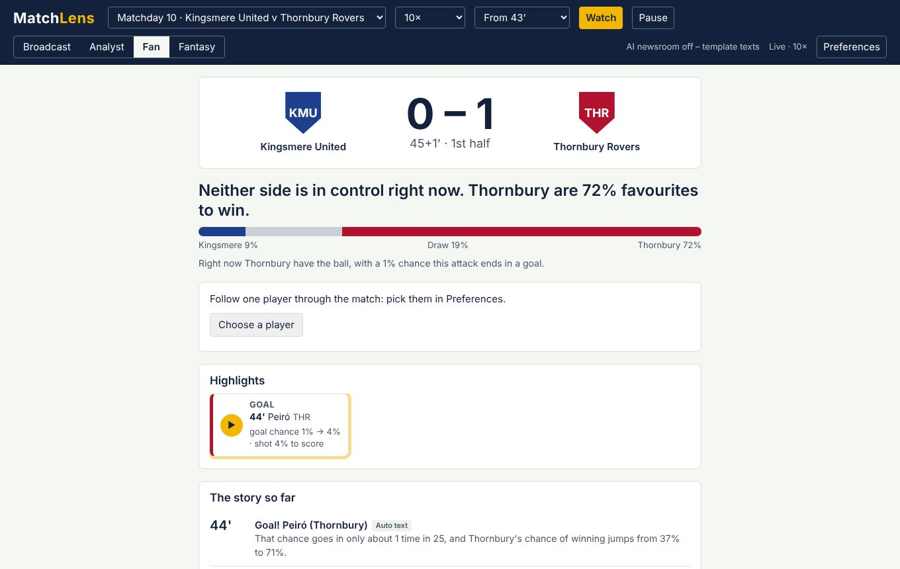
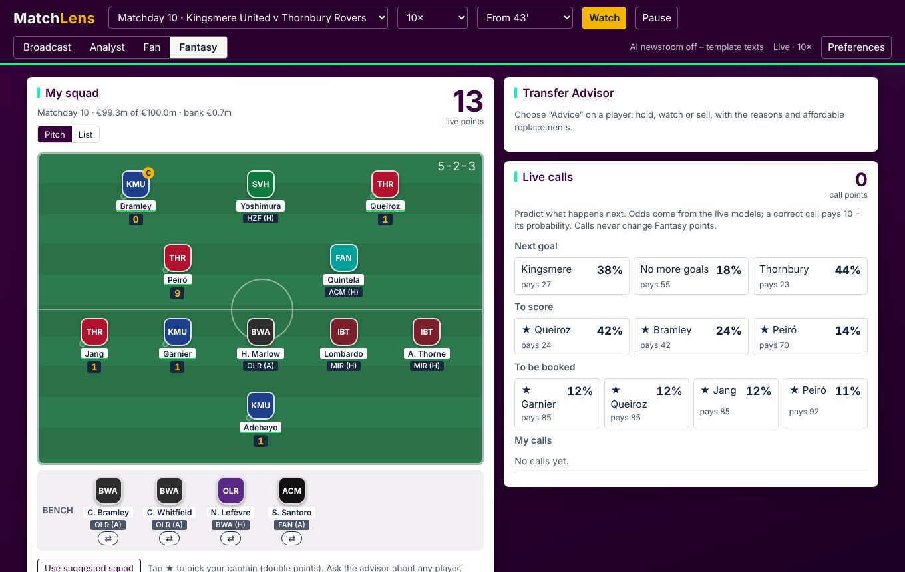
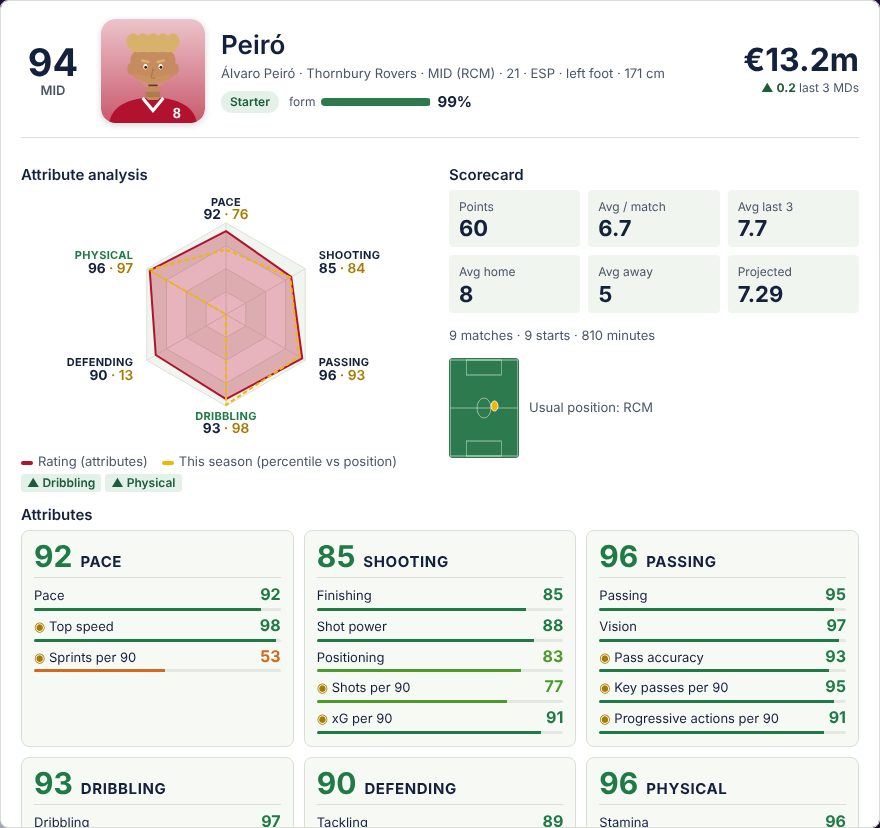

# MatchLens

**Explainable live match intelligence.** MatchLens turns a live stream of football events into numbers fans can trust, stories in their language, and fantasy decisions they can act on. Every number the AI writes is checked against the data before anyone sees it.

> Built for the Microsoft Premier League Hackathon. All data is **synthetic**: the Aurora League, its 10 clubs, 230 players and referees are invented, so no real league, club, player or broadcast data is used.

**Live demo:** `<your Azure Container Apps URL>` · **Video:** `<link>` · **Run it locally in 2 minutes:** [Quick start](#quick-start)



## What it does: ingest → interpret → explain → render → personalise

| Stage | What MatchLens does | Where |
|---|---|---|
| **Ingest** | A possession-chain simulator generates realistic event data (passes, carries, shots, sprints, cards, subs, physical snapshots) for a full 18-matchday season, replayed as a timed live feed | `matchsim/` |
| **Interpret** | A live state engine computes possession, field tilt, PPDA (pressing), xG, pass difficulty, momentum and chaos, live player ratings, and win / next-goal probabilities from models trained on 3,000 simulated matches | `matchlens/state.py`, `models.py` |
| **Explain** | A multi-agent newsroom on Microsoft Foundry writes commentary, fan and analyst lines, and half/full-time reports, grounded in a fact sheet and checked by a deterministic fact checker | `matchlens/newsroom/` |
| **Render** | Timed WebSocket messages drive broadcast graphics (score bug, win-probability strip, player tags with speed, lower thirds) and an OBS/vMix-ready transparent overlay | `matchlens/server.py`, `static/` |
| **Personalise** | Broadcast, Analyst, Fan and Fantasy views; 7 commentary languages; favourite club and player; live Fantasy points with reasons, live calls and a Transfer Advisor agent | `matchlens/fantasy/` |

### The hackathon's required elements

| Required | In MatchLens |
|---|---|
| Player tagging with speed indicators | Name tags on the live pitch with sprint speed (km/h), match-record sprints, distance covered |
| Pass quality and difficulty | Pass-difficulty model (0–100, AUC 0.79) with reasons; pass map coloured by difficulty; "pass of note" graphics |
| Ball and shot speed | Ball release speed per pass, shot speed per shot, "rocket shot" alerts |
| Probability of scoring | Live **goal chance** of the team on the ball, updated every touch (calibrated model), plus xG per shot; shown on the broadcast, in the fan view and in every highlight (*goal chance 1% → 6% · xG 0.04*) |
| Highlights | Data replays of goals, big chances, great saves and penalties in a picture-in-picture player, with slow motion and a downloadable clip |
| Narratives and recaps | Live commentary, fan and analyst lines for every key moment; studio script, article, social post and player of the match at half and full time |
| Explainability: control vs chaos, pressing, rhythm | Momentum and chaos indices (validated against the simulator's hidden ground truth), PPDA, field tilt, rhythm (passes, turnovers, fouls per 5 min), win-probability swings with their cause |
| Synthetic data | Everything: league, players, matches, season, fantasy prices |
| Multi-language output | Commentary in English, Spanish, French, German, Italian, Portuguese and Dutch by localiser agents; menus in English and Spanish |

## Architecture



Both workflows are Microsoft Agent Framework graphs. Dotted lines are MCP tool calls and model calls.

**Microsoft technologies**

- **Microsoft Foundry:** hosts the model the agents use, connected through the project endpoint with an Entra sign-in or API key.
- **Microsoft Agent Framework:** three workflows built from executors, conditional edges (the fact-check retry loop) and concurrent fan-out (the localisers): moment newsroom, recap newsroom and Transfer Advisor. Goals and red cards get the full Analyst step; other moments take a quicker path straight to the Writer.
- **Model Context Protocol:** the live engine is exposed as an MCP server with seven read-only tools (`list_matches`, `get_match_state`, `get_player`, `get_timeline`, `get_pre_match`, `get_moments`, `get_fantasy_player`). The agents use it, and so does **GitHub Copilot** in VS Code (`.vscode/mcp.json`), so an analyst can ask *"who is controlling the match and why?"* in plain language.
- **Azure Container Apps:** runs the whole app as one container, with scale to zero when idle.
- **GitHub Actions:** runs the tests, then builds and pushes the image to GitHub Container Registry.

## Agentic design: the model writes, code decides what is true

1. **Fact sheets first.** For each moment, deterministic code builds a fact sheet: every number the agents may use, plus context (game situation, win-probability swing, xG, streaks, table).
2. **Specialised agents.** The Analyst (with MCP tools) decides why the moment matters. The Writer produces four texts for two audiences. The Localisers translate concurrently. The Transfer Advisor explains a verdict.
3. **A fact checker that is code, not a model.** Any number not in the fact sheet or a tool result, jargon in fan texts, a goal story that doesn't name the scorer, or a changed Fantasy verdict goes back to the agent with the exact problems. After 2 retries, safe template text is published instead.
4. **Never blocks the broadcast.** Every moment appears instantly as template text and is upgraded in place when the agents finish. A deadline-aware priority queue never drops goals, red cards or recaps.
5. **Transparent by default.** Every text carries a trace (agents, tool calls, fact-check results, retries, timings), shown under *"How this was written"*, and a badge: *AI · fact-checked* or *auto text*.

Decisions stay explainable. Fantasy verdicts (HOLD / WATCH / SELL) come from transparent rules, with each factor listed next to its contribution. The model only explains the verdict. Fan predictions never change official Fantasy points.

## The four views

| | |
|---|---|
|  **Analyst:** win probability, xG race, momentum and chaos, team stats, shot and pass maps, player table, analyst notes and match report |  **Fan:** plain-language headline of who is on top, win-probability tug of war, the story so far, followed player |
|  **Fantasy:** your XI on the pitch with live points and reasons, fixtures grid, live calls with fair model odds, Transfer Advisor |  **Player profile:** attribute hexagon (rating vs this season), EA FC-style attribute breakdown, scorecard, points by matchday, last 5 / next 5 |

## Quick start

```bash
git clone https://github.com/r0sick/matchlens && cd matchlens
pip install -r requirements.txt
uvicorn matchlens.server:app            # open http://localhost:8000
```

Choose **Matchday 10 · Kingsmere United v Thornbury Rovers**, press **Watch**, and switch between the views. Without a model the app runs with template texts.

**Turn on the AI newsroom (Microsoft Foundry)**

1. Deploy a chat model in your Foundry project.
2. Copy `.env.example` to `.env` and set `FOUNDRY_PROJECT_ENDPOINT` and `FOUNDRY_MODEL`.
3. Sign in with `az login`, or add `AZURE_OPENAI_API_KEY`.
4. Check it with `python -m matchlens.newsroom`: it prints one goal's texts and the agent trace.

**Use MatchLens from GitHub Copilot:** with the server running, open the repo in VS Code. The `matchlens` MCP server in `.vscode/mcp.json` appears in Copilot agent mode.

**Tests:** `pip install -r requirements-dev.txt && python -m pytest -q`. The 21 tests run offline with a scripted model and cover the live stream, the no-look-ahead rule, grounding, retries, localisation, MCP tools and Fantasy.

**Deploy:** `docker build -t matchlens .`, or use the image GitHub Actions publishes (`ghcr.io/r0sick/matchlens:latest`) on Azure Container Apps. Use port 8000, the same environment variables as `.env` (the key as a secret), and 1 replica, because live sessions are held in memory.

## Trust and responsible AI

- **Synthetic data only.** No real players, clubs, footage or personal data. Player portraits are illustrations generated from the player ID.
- **Grounding.** Numbers are checked before publication, and the fact checker and its retries are unit-tested.
- **Provenance.** Every AI text is labelled and traceable, and falls back to deterministic text if the model is slow, down or wrong.
- **No look-ahead.** The live engine and every view only see events up to the current second, and Fantasy only sees earlier matchdays. Both are tested.
- **Fair play for fans.** Live-call payouts are set so every call has the same expected value, so there is no "safe farm". Calls are a separate game and never change Fantasy points.

## How it works in detail

### Stage 1 – live match intelligence (`matchlens/`)

```bash
python -m matchlens data/matches/M000042 --speed 60           # live dashboard: stats, win probability, alerts
python -m matchlens data/matches/M000042 --speed 600 --alerts-only --no-minor
python tools/match_report.py data/matches/M000042 --out report.png   # chart vs hidden ground truth
python tools/train_models.py --matches 3000                   # retrain models (needs numpy + scikit-learn)
```

- `matchlens/state.py` – `MatchState.update(event)` keeps live team/player stats, possession (total and last 5 min), field tilt, PPDA, momentum index, chaos index, live player ratings, and emits alerts (goal, win-probability swing, sprint ≥ 33 km/h, shot ≥ 105 km/h, hard pass completed, 45 m+ pass, big chance missed, 10 km covered, cards, subs). Uses only events seen so far.
- `matchlens/models.py` – pass difficulty (0–100 with reasons), win/draw/loss probability, next-goal probability and chaos index. All exported as JSON coefficients in `matchlens/model_files/`, so the live app needs no ML libraries and every number can be explained term by term.
- `model_files/training_report.json` – held-out evaluation: log loss vs naive prior, calibration tables, and correlation of the momentum and chaos indices with the simulation's hidden ground truth.

### Stage 2 – live server (`matchlens/server.py`)

```bash
pip install -r requirements.txt               # fastapi, uvicorn, Agent Framework, MCP
uvicorn matchlens.server:app --reload         # then open http://localhost:8000
python -m pytest -q                           # end-to-end tests (pip install -r requirements-dev.txt)
```

The server replays any demo or season match through the live engine and streams timed, machine-readable
messages over a WebSocket (`/ws/{match_id}?speed=60`): `hello`, `state`, `event`, `alert`,
`win_prob_swing`, `minute`, `players`, `session`. Several screens can watch the same match. Pause, resume,
speed and restart work over the socket or REST. The full message spec is in `OVERLAY.md`; the page at `/test`
is a raw test client showing the scoreboard, win probability, stats and alert feed.

### Stage 3 – the app (`http://localhost:8000`)

One stream, three ways to watch it (switch at the top right):

- **Broadcast** – a live 2D "event cam" of the pitch with broadcast graphics: score bug, win-probability strip,
  momentum ribbon, player name tags with speed and pass-difficulty indicators, and lower thirds for goals, cards,
  substitutions, rocket shots, top speeds and win-probability swings.
  Add `?view=overlay` for the graphics alone on a transparent background, ready to layer over video in OBS or vMix.
- **Analyst** – win probability, xG race, momentum and chaos charts, shot map, pass map coloured by difficulty,
  team stats and a sortable player table with live ratings.
- **Fan** – the score, a plain-language headline of who is on top and why, a win-probability tug of war,
  the story of the match with "why it matters" context, and a card for the player you follow.

**Preferences** (saved in the browser): language (English, Spanish), favourite club, player to follow. The
followed player gets a ★ on the pitch tags, in the feeds and timeline, and their own stats card.
Links can carry settings: `/?match=M000042&mode=fan&speed=60&from=60&lang=es`.

### Stage 4 – AI newsroom: multi-agent narratives on Microsoft Foundry (`matchlens/newsroom/`)

Every important moment (goals, red cards, big chances, a "state of play" read every 15 minutes,
half time and full time) is turned into commentary, a plain-language fan line, a data-rich analyst
line and, at half/full time, a studio script, article, social post and player of the match, in
several languages. It is built with **Microsoft Agent Framework** on **Microsoft Foundry**:

```
 live engine ──► fact sheet ──► Analyst ──► Writer ──► Fact checker ──► Localisers ──► Publisher
 (matchlens)   (every number     (calls the    (two       (code, not a    (one agent     (WebSocket
               the AI may use)   MCP tools)    audiences)  model)  │       per language,  "narrative"
                                       ▲                           │       concurrent)    message)
                                       └──── retry with the exact problems (max 2) ───┘
```

- **Grounded by construction.** A deterministic fact sheet (`matchlens/facts.py`) holds every number
  the writers may quote. The fact checker rejects any number that is not in the fact sheet or in a tool
  result the agents actually received, jargon in fan texts, and goal stories that don't name the scorer.
  Failures go back to the writer with the exact problems; after two retries the safe template text is used.
- **MCP server over the live engine** (`matchlens/mcp_server.py`, mounted at `/mcp`): `list_matches`,
  `get_match_state`, `get_player`, `get_timeline`, `get_pre_match`, `get_moments`. The analyst and recap
  agents call it for context; GitHub Copilot in VS Code can use it too (`.vscode/mcp.json`), so you can ask
  Copilot about the live match.
- **Never blocks the broadcast.** Each moment is published instantly from templates (`status: "draft"`)
  and upgraded in place when the agents finish (`status: "final"`). A bounded, deadline-aware queue drops
  low-priority moments when the replay outruns the models; goals, red cards and recaps are never dropped.
- **Transparent.** Each narrative ships with a trace (agents, tool calls, fact-check results, retries,
  timings) shown in the app under "How this was written", and a badge: AI · fact-checked, or auto text.

#### Connect your Foundry project

1. In the Foundry portal deploy a small, fast chat model in your project.
2. Copy `.env.example` to `.env` and fill in `FOUNDRY_PROJECT_ENDPOINT` (project Overview page) and
   `FOUNDRY_MODEL` (the deployment name).
3. Sign in once with the Azure CLI: `az login` (or use the API-key option in `.env.example`).
4. Check it: `python -m matchlens.newsroom` prints the agents' texts and the trace for one goal.
5. Run the app as usual (`uvicorn matchlens.server:app`); the top bar shows "AI newsroom: Microsoft Foundry".

Without a `.env` everything still works with template texts (English and Spanish).

In code, the ingest stage can consume the same feed:

```python
from matchsim.replay import load_match, iter_live
m = load_match("data/matches/M000042")
for ev in iter_live(m["events"], speed=60):
    ...  # push into the interpretation layer
```

### Stage 5 – Fantasy: live points, live calls and a Transfer Advisor (`matchlens/fantasy/`)

Open the **Fantasy** tab while watching a matchday match (e.g. *Matchday 10 · Kingsmere United v Thornbury Rovers*).

- **Live points with reasons.** Every point has a reason ("Goal +5", "60+ min +2", "Yellow −1",
  "Bonus +3 provisional"). Rules are in `matchlens/fantasy/scoring.py`. The same scorer runs live and
  built the season table (`python tools/build_fantasy.py` → `data/season_2026-27/fantasy.json`), and a
  test checks that live totals equal the season table. Fan input never changes official points.
- **Squad.** 15 players (2 GK, 5 DEF, 5 MID, 3 FWD), €100m, at most 3 per club. Prices start from player
  quality and position and move with form. A suggested squad is ready-made; transfers are made from the advisor.
- **Live calls.** Next goal, to score, to be booked, with odds from the live models (next-goal model,
  each player's share of their club's expected goals, fouls and chaos for cards). A correct call pays
  10 ÷ probability, so every call is worth the same on average: skill at reading the match, not safe picks.
- **Transfer Advisor** (Agent Framework workflow): `Scout` (code: form vs price, season output,
  goals vs xG, minutes trend, next fixtures → HOLD / WATCH / SELL and affordable replacements) →
  `Advisor` agent (explains, may call the MCP tool `get_fantasy_player`) → deterministic `FactChecker`
  (numbers grounded, verdict unchanged, only listed replacements) with retries → `Localiser`.
  The verdict is decided by transparent rules; the model only explains it. Without AI, template text.

No spoilers: Fantasy data is always "as of" the matchday being watched.

### What the engine models

- **Fictional Aurora League**: 10 clubs across 7 fan markets (en, es, fr, de, it, pt, nl) with distinct formations (4-3-3, 4-2-3-1, 4-4-2, 3-5-2, 3-4-3) and tactical styles (possession, press, directness, tempo, width, line height). Squads of 23 with 14 nationalities and 12 attributes per player.
- **Possession-chain engine**: each touch can be pressed, then becomes a carry + pass, dribble, cross, shot or clearance. Outcomes depend on attributes, both teams' shapes (defenders in the passing lane, receiver space, offside line), fatigue, weather and squad quality.
- **Latent match story**: a momentum process (home advantage, goal shocks) and a chaos level (goals, red cards, late pressure) drive phases of control and chaos; trailing teams push higher and press harder after ~55', leaders drop deeper. These are exported as hidden ground truth so explainability can be scored.
- **Tracking-lite**: sprints with top speed, distance and high-intensity running per player, 5-minute physical snapshots, ball release speed per pass and shot speed per shot – the raw material for speed/distance overlays.
- **Season mode**: standings, form, head-to-head, season and career stats, scoring streaks and milestone watch lists feed each match's pre-match context.

### Realism check (200 matches, per team per match)

| metric | sim | typical top flight |
|---|---|---|
| goals | 1.55 | 1.4 |
| xG | 1.52 | 1.4 |
| shots / on target | 13.2 / 4.8 | 12.5 / 4.3 |
| passes / accuracy | 494 / 80.1% | 470 / 81% |
| corners / crosses | 3.9 / 17.0 | 5.0 / 16 |
| fouls / yellows / offsides | 10.5 / 1.7 / 2.0 | 10.5 / 1.9 / 1.8 |
| tackles / interceptions / dribbles | 18.6 / 11.4 / 8.8 | 17 / 9 / 9 |
| distance / sprints | 110.2 km / 125 | 110 km / ~120 |

Home win / draw / away win over 400 matches: 43% / 22% / 35%. Ball in play ≈ 58 min. Reference values are approximate league-wide averages used as calibration targets.

### Model quality (held-out 20% of 3,000 training matches)

| model | metric | ours | scoreline + clock only | no information |
|---|---|---|---|---|
| win / draw / loss | log loss | **0.582** | 0.648 | 1.047 |
| next goal | log loss | **0.873** | 0.925 | 1.099 |
| pass difficulty | AUC | **0.79** | – | 0.50 |
| live goal chance (per touch, 2,000 matches) | log loss / AUC | **0.106 / 0.69** | – | 0.113 / 0.50 |

Momentum index vs the simulation's hidden momentum: correlation 0.64. Chaos index vs hidden chaos: 0.43 (it tracks the direction well but under-reads the most extreme spells). Full tables in `matchlens/model_files/training_report.json`.


## Repository map

| Path | What |
|---|---|
| `matchsim/` | League, squad and season generation; possession-chain match engine; replay and box score |
| `matchlens/state.py`, `models.py`, `facts.py` | Live engine, models (JSON coefficients), moment detector and grounding helpers |
| `matchlens/server.py`, `static/` | FastAPI + WebSocket server; web app (Broadcast, Analyst, Fan, Fantasy) |
| `matchlens/newsroom/` | Agent Framework workflows, prompts, templates, model provider, newsroom queue |
| `matchlens/mcp_server.py` | MCP server over the live engine |
| `matchlens/fantasy/` | Scoring, prices, live calls, season data and profiles, Transfer Advisor workflow |
| `tools/` | Validation, model training, match report, Fantasy season builder |
| `OVERLAY.md`, `SCHEMA.md` | Live protocol and event schema |
| `tests/` | Offline end-to-end and agent tests |

License: MIT. All names, clubs and players are fictional.
